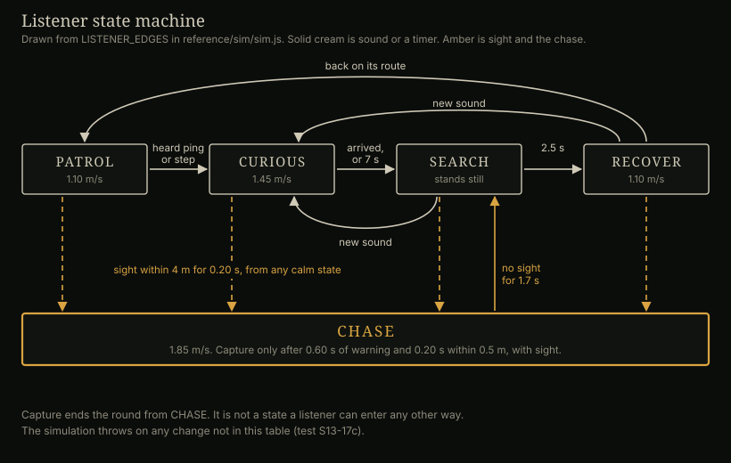

# Listener behaviour, Stage 13

_Generated by `tools/predator/gen_docs.js`. Do not edit by hand. `npm run test:stage13` fails if this file and the code disagree._

## Transition table

| From | To | On | Guard | Exercised by |
|---|---|---|---|---|
| PATROL | CURIOUS | heard a ping or a footstep | sound reached it through connected floor within its hearing limit | L01 navigator@0 |
| RECOVER | CURIOUS | heard a ping or a footstep | same | fixture echo during recover |
| SEARCH | CURIOUS | heard a ping or a footstep | same: a new sound resets the investigation | fixture echo during search |
| CURIOUS | SEARCH | arrived or timed out | within 0.5 m of the heard origin, or 7.0 s walking | L01 navigator@0 |
| SEARCH | RECOVER | timer | 2.5 s standing at the origin | L01 navigator@0 |
| RECOVER | PATROL | arrived | back on its route | fixture full cycle |
| PATROL | CHASE | sight | line of sight over connected floor, within 4.0 m, for 6 ticks (0.20 s) | L01 blind@0 |
| CURIOUS | CHASE | sight | same | L01 six@180 |
| SEARCH | CHASE | sight | same | fixture sight during search |
| RECOVER | CHASE | sight | same | fixture sight during recover |
| CHASE | SEARCH | lost | no sight for 1.7 s | fixture lost sight |

The simulation throws on any change that is not in this table (test S13-17c).

## Numbers, both profiles

`suspense` is the approved EC-RULESET-01 and changes nothing. `forgiving` is a proposal for you to compare. Neither profile goes below the prompt minimums of a 0.60 s warning and 0.18 s of sight.

| Rule | suspense | forgiving |
|---|---|---|
| Patrol speed (m/s) | 1.1 | 1.1 |
| Investigating speed (m/s) | 1.45 | 1.45 |
| Chase speed (m/s) | 1.85 | 1.6 **changed** |
| Hearing limit scale (11 m at 1.0) | 1 | 0.82 **changed** |
| Longest walk to a sound (ticks) | 210 | 150 **changed** |
| Search at the origin (ticks) | 75 | 60 **changed** |
| Chase lost after no sight (ticks) | 51 | 51 |
| Sight radius (m) | 4 | 3.2 **changed** |
| Sight before chase (ticks) | 6 | 6 |
| Warning before capture (ticks) | 18 | 27 **changed** |
| Capture radius (m) | 0.5 | 0.5 |
| Contact needed to capture (ticks) | 6 | 6 |
| Footstep reach, walking (m of floor) | 2.5 | 1.8 **changed** |
| Quiet step noise factor | 0.3 | 0.3 |

30 ticks are one second. Hearing limit is in weighted metres of connected floor, never straight line.

## Scenarios and what each proves

| Id | What it shows |
|---|---|
| S13-04 | Hearing an old origin: it walks to where the echo was cast while you are 9 m away. "It heard where you were, not where you are." |
| S13-05 | Seeing the current player: sight alone, no echo, starts a chase after 6 ticks. |
| S13-06 | Sealed wall: 24 echoes and 30 s next to a listener 3.2 m away through a wall cause nothing. S13-06c adds a doorway and the same inputs are heard. |
| S13-06d | Hairpin: 41 positions within 4 m through a wall never chase; 28 in sight always do. |
| S13-07 | Capture delay: standing inside capture range, the capture still waits for the full 0.60 s. |
| S13-07d | Telegraph: the alert is in the snapshot on every chase tick before a capture. |
| S13-08 | Lost sight: search starts after exactly 51 ticks, lasts exactly 75, then recovers. |
| S13-09 | A second echo moves the remembered origin and restarts the investigation. |
| S13-10 | Memory: it searches an old origin you have left, goes home, and never returns without a new sound. |
| S13-10d | A sound heard from 11 m is investigated for 7 s, so it stops about 0.8 m short. |
| S13-11 | Quiet step: walking is heard at 6 m, quiet is not (reach 1.8 m). A ping is equally loud either way. |
| S13-13 | Explanation: built from the cause chain, identical under tampering, nothing while the round runs. |
